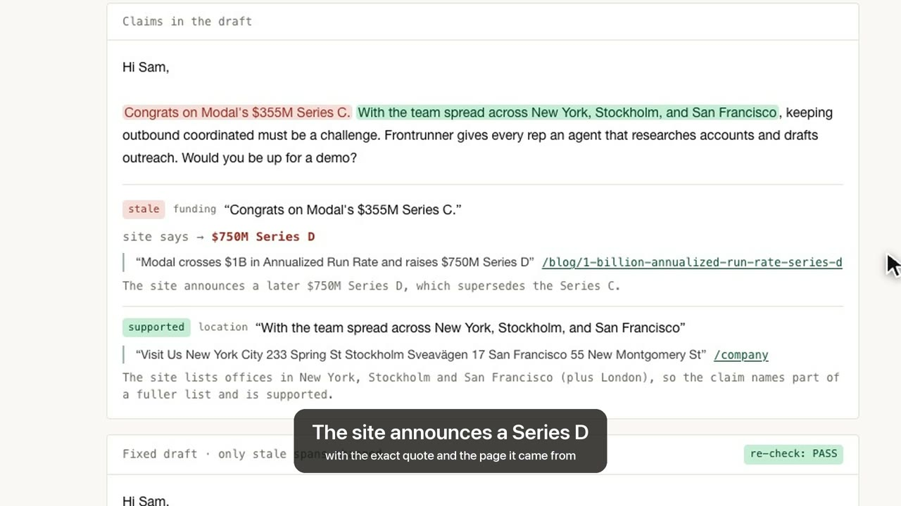

# presend-fact-check

A send-layer check that reads every factual claim in an AI-written outreach email, checks it against the prospect company's **live website**, and blocks the send when the site says something newer. Stale facts were the #1 failure in Frontrunner's [PipelineBench](https://usefr.com/pipelinebench): with a year-old prospect database, models used the stale number about half the time, even when the company's own site said otherwise.


**Demo (44 s):** [watch the video](https://github.com/Christopher4113/presend-fact-check/releases/download/v0.1.0/presend-demo.mp4). A stale "Series C" is blocked, corrected to the $750M Series D from modal.com with the quote and source, fixed and re-checked.

[](https://github.com/Christopher4113/presend-fact-check/releases/download/v0.1.0/presend-demo.mp4)

```
ProspectRecord (maybe stale) + draft
  1. extract claims   Groq, JSON mode, temp 0   funding, headcount, title, product, customer, location, news
  2. gather evidence  company site only          home, /about, /team, /careers, /blog, /press + sitemap; ≤15 pages; BM25 top-4 chunks + page headlines per claim
  3. verify           Groq judge per claim       supported | stale | unverified, + corrected value, source URL, verbatim quote
  4. decide           pure function              any stale → BLOCK · unverified funding/headcount/title → REVIEW · else PASS
  5. fix (optional)   minimal rewrite            change only the stale spans, then re-check
```

## Results

Live run on 2026-11-22 against each company's own website, `openai/gpt-oss-120b` on Groq. All 10 cases are real startups; labels are dated **2026-11-22** because sites change.

| case | category | domain | expected | decision | latency | pages |
|---|---|---|---|---|---|---|
| browserbase_stale | stale | browserbase.com | BLOCK | BLOCK | 5.7s | 11 |
| clerk_stale | stale | clerk.com | BLOCK | BLOCK | 46.9s | 10 |
| encord_stale | stale | encord.com | BLOCK | BLOCK | 87.9s | 5 |
| modal_stale | stale | modal.com | BLOCK | BLOCK | 71.3s | 9 |
| e2b_correct | all-correct | e2b.dev | PASS | PASS | 20.5s | 9 |
| resend_correct | all-correct | resend.com | PASS | PASS | 33.6s | 11 |
| trigger_correct | all-correct | trigger.dev | PASS | PASS | 28.6s | 9 |
| inngest_unverifiable | unverifiable | inngest.com | REVIEW | REVIEW | 7.1s | 10 |
| warp_unverifiable | unverifiable | warp.dev | REVIEW | REVIEW | 28.1s | 10 |
| mintlify_tricky | tricky | mintlify.com | BLOCK | BLOCK | 42.7s | 9 |

- **Decisions:** 10/10 correct.
- **Stale, claim level:** precision **1.00** (5/5 BLOCKs were right), recall **1.00** (5/5 stale facts caught).
- **Pages fetched per domain:** 5–11, median 9.5 (cap is 15).
- **Latency:** median **31 s** per draft, including `--fix` and the re-check. The spread (5.7 s to 88 s) is almost all Groq free-tier rate limiting (8k tokens/min, so the SDK backs off on 429s). Unthrottled runs took 2–9 s.
- **Consistency (stretch), 5 runs each on Modal, Encord, Clerk:** every claim 5/5, every decision 5/5. Full output in `results/consistency.txt`.

Full output: `results/latest.md` and `results/latest.json`. The UI's Benchmark tab reads the same file.

### Before / after: Modal

The CRM record was enriched in July 2025 and still says Series C.

**Draft**
> Congrats on Modal's $355M Series C. With the team spread across New York, Stockholm, and San Francisco, keeping outbound coordinated must be a challenge. …

**BLOCK**
| claim | verdict | site says | source |
|---|---|---|---|
| "Modal's $355M Series C" | stale | $750M Series D | [/blog/1-billion-annualized-run-rate-series-d](https://modal.com/blog/1-billion-annualized-run-rate-series-d): "Modal crosses $1B in Annualized Run Rate and raises $750M Series D" |
| "team spread across New York, Stockholm, and San Francisco" | supported | | [/company](https://modal.com/company) |

**Fixed draft** (re-check: PASS)
> Congrats on Modal's **$750M Series D**. With the team spread across New York, Stockholm, and San Francisco, keeping outbound coordinated must be a challenge. …

### What the first run got wrong, and the fixes

The first live run scored **5/10 with stale recall 0.2**. The checker made the same mistake PipelineBench describes: company sites keep old announcements online. Clerk's "$30M Series B" post, Modal's "Series C" post and Mintlify's "Series A" post are all still live, so the judge found a page that "confirmed" the stale claim and passed it. Three fixes:

1. **Page headlines as evidence.** BM25 on the claim's own words ("Series B") retrieves the old post best. Every page's title and meta description that announces a round now goes to the judge too, so it sees "Clerk raises $50m Series C" next to the Series B post.
2. **A deterministic later-round guard** (`verify.later_round_guard`). If a funding claim comes back `supported` but a headline on the same site names a later round, code flips it to `stale` with that headline as the quote. Before this, Modal passed in one full run and blocked in another.
3. **Navigation and footers stripped** before chunking. Menus repeated on every page were crowding the real text out of the top-4.

Two more findings from the runs:

- **My label was wrong, not the checker.** The first E2B draft said "88 of the Fortune 100". The checker marked it stale: the homepage now says 94, and the 88 on /about is "at the time" of the Series A. The draft now uses 94.
- **The re-check caught the fixer's mistake.** On Clerk, the minimal rewrite produced "Series C from CRV", but CRV led the B, not the C. Re-verification returned REVIEW instead of PASS. This is why the fixed draft goes through the check again.

## Run it locally

```bash
cp .env.example .env          # add GROQ_API_KEY; GROQ_MODEL defaults to openai/gpt-oss-120b
uv sync
uv run python cli.py cases/browserbase_stale.json --fix
uv run python cli.py --all --fix                 # every case + stale precision/recall → results/latest.md
uv run python cli.py cases/clerk_stale.json --runs 5   # consistency: agreement per claim, flags flaky ones
uv run pytest                                    # no network, no LLM
```

**LLM provider.** Groq (`openai/gpt-oss-120b`) is the default and produced the results above. Set `LLM_PROVIDER=anthropic` (with `ANTHROPIC_API_KEY`) to run the same pipeline on Claude (`claude-opus-5-5`, structured outputs via `messages.parse`, effort `low`). The demo video was recorded on Claude because the Groq free tier's 200k tokens/day ran out.

Pages are cached in `.cache/pages/` (by URL, with fetch time) so reruns are fast; pass `--fresh` to refetch.

Demo UI (React + Vite, styled after usefr.com) on top of the FastAPI endpoint:

```bash
uv run uvicorn presend_check.server:app --port 8000
npm --prefix web install && npm --prefix web run dev   # http://localhost:5173
```

`POST /check {prospect, draft, fix}` returns a `CheckResult`. `POST /check/stream` returns the same thing as NDJSON progress events (claims, pages, verdicts), which the UI renders as an agent trace.

### What it reads

**Company websites only.** No LinkedIn, no logged-in pages, no third-party data. It fetches with a User-Agent naming this repo, honours `robots.txt`, uses a 10 s timeout and never reads more than 15 pages per domain. Sites that render everything with JavaScript return little text; those claims come back `unverified` (never guessed), which routes risky ones to REVIEW.

### Guardrails on the judge

- A `supported` or `stale` verdict must carry a quote copied **verbatim** from one of the chunks. This is checked in code (`verify.enforce_quote`): if the quote is not a substring of the evidence (after whitespace/case/curly-quote normalisation) the verdict is downgraded to `unverified`. The source URL is taken from the matching chunk, not from the model.
- `stale` requires the page to state something different **and more recent**. Missing evidence is `unverified`, never `stale`.
- Funding claims also go through `later_round_guard`: a `supported` verdict flips to `stale` if any headline on the site names a later round.
- JSON output is validated with pydantic; one retry with the validation error appended.

## How this fits into your system

**Where it plugs in.** In the send layer, next to suppression, Do Not Contact and open-deal checks, so it holds no matter what the agent believed. `check(prospect, draft) -> CheckResult` runs before any sequence step sends:

- `BLOCK` goes back to the drafting agent with the corrections (claim, corrected value, source URL, quote). The agent rewrites, or `--fix` does a minimal rewrite and the check runs again.
- `REVIEW` goes to a person's inbox: the draft makes a funding, headcount or title claim the site can't confirm.
- `PASS` sends.

**Feeding the data layer.** Every `stale` verdict is a fresh fact with a source URL and a quote. Write it back to the prospect/account record (`funding_stage = "Series B"`, `source = browserbase.com/about`, `observed_at = now`) so the next agent starts from the corrected record, not just this email. Over time this is a cheap, targeted re-enrichment loop driven by the facts agents actually try to use.

**As a benchmark metric.** PipelineBench already measures the pipeline outcome. Add the stale-fact rate per model or harness version next to it: share of drafts that would have been BLOCKed, and stale precision/recall on a labelled set like `cases/`. The `--runs 5` mode reports per-claim agreement, which speaks to the "1 in 10 model/task pairs passed one run and failed the next" finding directly.

**What production still needs.**

- More sources than the company site: news, funding databases, and the enrichment providers you already pay for, with a source-priority order.
- Freshness thresholds per field (a title from 18 months ago is riskier than a location), so only claims older than their threshold get checked.
- JS-rendered sites (a headless fetch fallback) and a per-domain page budget smarter than a fixed path list.
- Cost and latency budgets per send: cache verdicts per (domain, claim) across a whole sequence, batch claims into one judge call, and run the check when the draft is created rather than at send time.
- A review-queue UI for REVIEW, with one-click accept of the corrected value.
- A paid inference tier. On Groq's free tier (8k tokens/min) runs are rate-limited; the SDK backs off on 429s.

## Layout

```
presend_check/
  models.py       ProspectRecord, Claim, Evidence, ClaimVerdict, CheckResult
  llm.py          Groq via the OpenAI SDK, JSON mode, temp 0, one retry on schema error
  claims.py       draft -> list[Claim]
  evidence.py     domain -> pages -> chunks; robots.txt; disk cache; BM25 top-k per claim
  verify.py       (claim, chunks) -> ClaimVerdict; verbatim-quote check
  decide.py       verdicts -> PASS / REVIEW / BLOCK (pure)
  fix.py          minimal rewrite of stale spans
  consistency.py  run N times, agreement per claim, flaky flag
  server.py       FastAPI: /check, /check/stream, /cases, /results
cli.py            single case, --all, --fix, --runs N, --fresh, --resume
tools/demo/       reshoot storyboard + edit script for the demo video (see its README)
cases/            10 labelled cases (real startups, labelled 2026-11-22)
tests/            pytest, no network and no LLM
web/              React demo UI
```

## License

MIT
